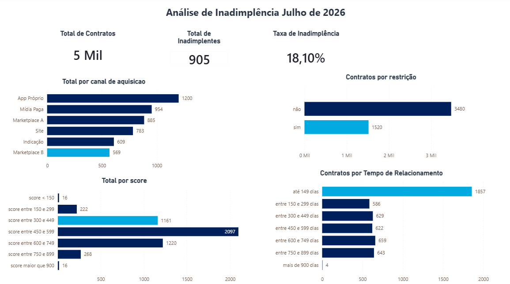

# Análise de Inadimplência em Operações de Crédito


---

## 🎯 Problema de Negócio

Uma fintech de crédito popular voltada para as classes C e D enfrenta perdas financeiras causadas pela inadimplência em sua carteira de empréstimos. A liderança de crédito precisa decidir **como ajustar os critérios de concessão** para reduzir o risco sem comprometer o volume de contratos aprovados.

Este projeto utiliza análise exploratória com SQL e Python para identificar **quais perfis de cliente concentram maior risco de inadimplência**, fornecendo insumos concretos para a revisão da política de crédito da empresa.

> **Pergunta central:** Existe um perfil de cliente que concentra uma taxa de inadimplência significativamente superior à média da carteira?

---

## 🔍 Principais Achados

> Taxa geral de inadimplência da carteira: **18,10%**

| # | Achado | Impacto no Negócio |
|---|---|---|
| 1 | **Canal Marketplace B** concentra **32,69%** de inadimplência | Quase o dobro da média — revisar ou pausar esse canal reduz exposição ao risco de forma imediata |
| 2 | **Clientes com até 149 dias** de relacionamento têm **23,10%** de inadimplência | Novos clientes são o segundo maior grupo de risco — limites progressivos de crédito nos primeiros meses protegeriam a carteira |
| 3 | **Score entre 300 e 449** é a faixa mais crítica da carteira | O modelo atual pode estar subestimando risco nessa faixa intermediária — revisão dos critérios de aprovação é recomendada |

---

## 💡 Impacto Esperado

Os resultados desta análise permitem à equipe de crédito:

- **Revisar critérios de aprovação** com base nos canais e perfis de maior risco identificados
- **Priorizar ações de cobrança preventiva** para segmentos com histórico de inadimplência acima da média
- **Ajustar limites e taxas** de acordo com o tempo de relacionamento e comprometimento de renda do cliente
- **Reduzir exposição ao risco** no canal Marketplace B, que apresentou a maior taxa de inadimplência da carteira (32,69%)

---

## 📊 Dashboard

<p align="center">
  
</p>

O dashboard desenvolvido em Power BI apresenta os principais indicadores da carteira:

- **KPIs gerais:** total de contratos, total de inadimplentes e taxa geral da carteira
- **Análise por canal de aquisição:** comparativo de taxa de inadimplência entre os canais, destacando o Marketplace B como principal ponto de atenção
- **Análise por segmento de risco:** cruzamento entre score interno e tempo de relacionamento para identificar os perfis mais críticos

---

## 📂 Estrutura do Projeto

```
Analise_Inadimplencia/
├── dados/
│   ├── raw/                          # Dados originais (não versionados)
│   └── processed/                    # Banco SQLite gerado pelo pipeline
├── dashboard/
│   └── analise_inadimplencia.png     # Imagem exportada do Power BI
├── documentos/
│   └── dicionario_de_dados.md        # Descrição de todas as variáveis
├── sql/
│   ├── 01_visao_geral.sql            # Taxa geral de inadimplência
│   ├── 02_risco_por_canal_e_restricao.sql
│   ├── 03_risco_por_historico_do_cliente.sql
│   └── 04_risco_por_perfil_financeiro.sql
├── src/
│   └── pipeline.py                   # Ingestão e persistência dos dados
├── requirements.txt
└── README.md
```

---

## 🚀 Como Reproduzir

```bash
# 1. Clone o repositório
git clone https://github.com/Luizcomzz/Analise_Inadimplencia.git
cd Analise_Inadimplencia

# 2. Crie e ative o ambiente virtual
python -m venv venv
venv\Scripts\activate        # Windows
# source venv/bin/activate   # Mac/Linux

# 3. Instale as dependências
pip install -r requirements.txt

# 4. Execute o pipeline (gera o banco SQLite a partir do CSV)
python src/pipeline.py

# 5. Abra os arquivos SQL em qualquer editor compatível com SQLite
#    (ex: DBeaver, DB Browser for SQLite) apontando para:
#    dados/processed/inadimplencia.db
```

> **Nota:** O arquivo CSV original (`dados/raw/`) não está versionado por boas práticas de privacidade. O banco SQLite em `dados/processed/` é gerado localmente pelo pipeline.

---

## 🔎 Hipóteses Analíticas

Antes da exploração dos dados, foram definidas hipóteses testadas durante a análise.

| Hipótese | Resultado | Conclusão |
|---|---|---|
| Score baixo → maior inadimplência | Parcialmente verdadeiro | A faixa 300–449 é mais crítica que as menores |
| Idade influencia inadimplência | Impacto limitado | Faixa até 26 anos lidera com 22,66%, mas diferença não é expressiva |
| Gênero influencia inadimplência | Não confirmado | Resultado equilibrado próximo à média (18,10%) |
| Menos tempo de relacionamento → maior risco | Confirmado | Até 149 dias: 23,10% de inadimplência |
| Canal de aquisição influencia pagamento | Confirmado e crítico | Marketplace B: 32,69% — quase o dobro da média |

---

## 📋 Metodologia

### 1. Compreensão dos dados
- Estudo do dicionário de dados e entendimento das variáveis
- Identificação do problema de negócio e formulação de hipóteses

### 2. Importação e exploração
Utilização do Python e Pandas para importar a base e realizar verificações de qualidade:
- Valores nulos · Registros duplicados · Tipos de dados · Cardinalidade por coluna

### 3. Modelagem dos dados
Importação da base para um banco SQLite, organizando os dados para consultas analíticas.

### 4. Análise exploratória
Consultas SQL segmentadas por canal, score, tempo de relacionamento, restrição de crédito e comprometimento de renda.

### 5. Geração de insights
Comparação das hipóteses com os resultados, com recomendações de negócio para cada achado.

### 6. Visualização
Dashboard no Power BI conectado ao banco SQLite, com indicadores e análises segmentadas.

---

## 🛠️ Tecnologias Utilizadas

| Ferramenta | Finalidade |
|---|---|
| [Python 3.14](https://www.python.org/) | Linguagem de programação principal |
| [Pandas 3.0](https://pandas.pydata.org/) | Exploração e preparação dos dados |
| [SQLite](https://sqlite.org/) | Modelagem e consultas analíticas |
| [Power BI](https://www.microsoft.com/pt-br/power-platform/products/power-bi/desktop) | Dashboard com indicadores de negócio |

---

## 👤 Autor

Desenvolvido por **Luiz** · [LinkedIn](https://linkedin.com/in/seu-perfil) · [GitHub](https://github.com/seu-usuario)